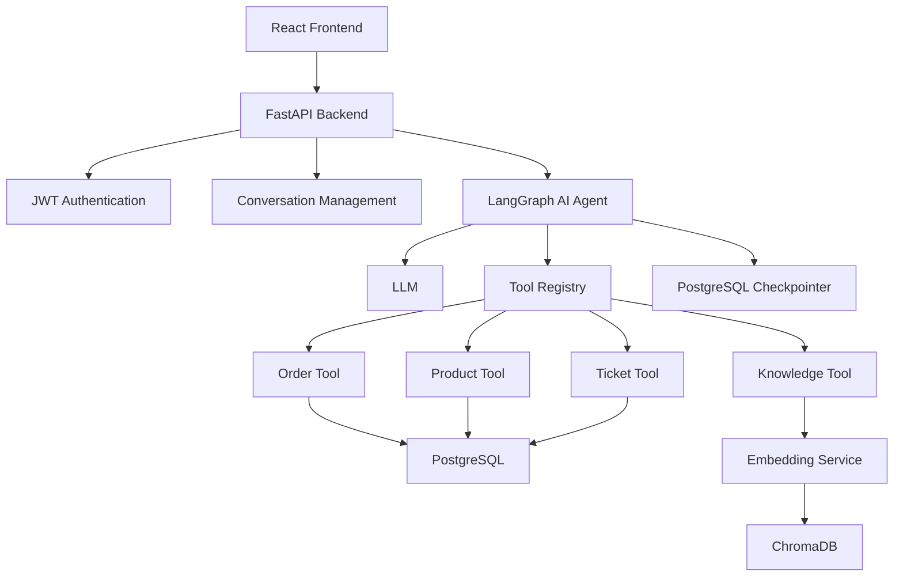
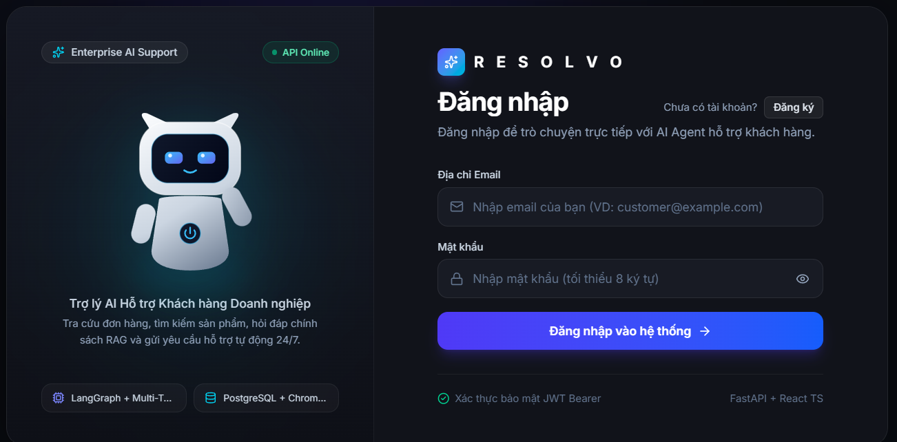
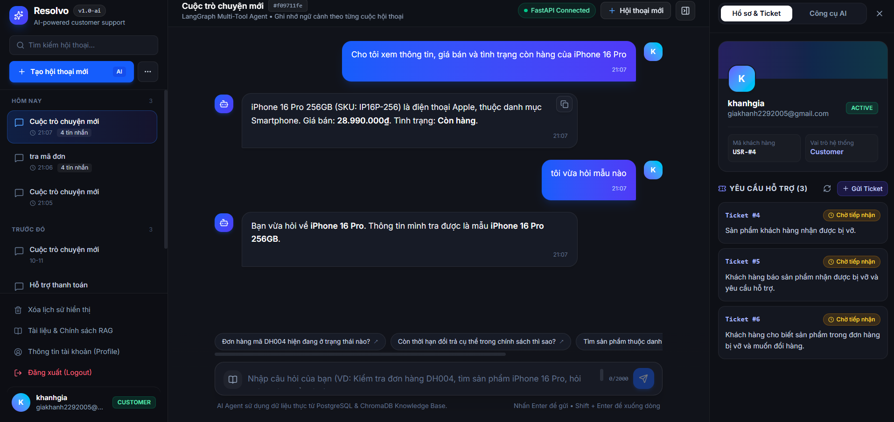
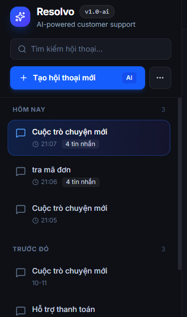

# Enterprise Customer Support AI Agent

A full-stack AI-powered customer support platform built with FastAPI, LangGraph, Retrieval-Augmented Generation (RAG), PostgreSQL, and React.

The project aims to automate common e-commerce customer service workflows through an intelligent AI Agent capable of retrieving order information, searching product data, creating support tickets, and answering policy-related questions using enterprise knowledge.

## Overview


Enterprise Customer Support AI Agent combines backend engineering and AI engineering into a single application.

The system integrates an LLM-powered agent with business tools, persistent conversation state, and a retrieval-based knowledge system.

## Key Features

### AI Agent & Tool Calling
- LLM-powered customer support assistant.
- Multi-tool calling architecture.
- Order status lookup.
- Product information retrieval.
- Customer support ticket creation.
- Tool Registry and centralized Tool Executor.

### Retrieval-Augmented Generation (RAG)
- Local text embeddings using Sentence Transformers.
- Vector storage and similarity search with ChromaDB.
- Markdown document ingestion.
- Configurable document chunking and overlap.
- Metadata-based filtering.
- Similarity threshold filtering.
- Retrieval evaluation using Hit Rate@K and Mean Reciprocal Rank (MRR).
- Rule-based baseline evaluation for generated answers.

### Conversation Management
- Conversation creation and management.
- JWT-based authentication.
- PostgreSQL-backed LangGraph checkpoint persistence.
- Conversation-specific thread identifiers.
- Persistent agent state across conversation turns.

### Backend & Data Management
- REST API built with FastAPI.
- PostgreSQL database integration.
- SQLAlchemy ORM.
- Pydantic request and response validation.
- Password hashing.
- Role-based access control.
- User-specific order and conversation access checks.

### Frontend
- React-based customer interface.
- TypeScript.
- Vite development environment.
- AI chat interface and conversation management.

## System Architecture



## Technology Stack

| Category | Technologies |
|---|---|
| Backend | Python, FastAPI |
| Frontend | React, TypeScript, Vite |
| Database | PostgreSQL |
| ORM | SQLAlchemy |
| Validation | Pydantic |
| Authentication | JWT |
| Password Hashing | Argon2 |
| AI Agent Framework | LangGraph |
| LLM Integration | OpenAI API |
| Vector Database | ChromaDB |
| Embedding Model | Sentence Transformers |
| Testing | Pytest |

## Project Structure

```text
enterprise-customer-support-ai-agent/
│
├── app/
│   ├── agents/
│   ├── api/
│   ├── core/
│   ├── knowledge_base/
│   ├── models/
│   ├── schemas/
│   ├── services/
│   └── tools/
│
├── frontend/
│   ├── public/
│   ├── src/
│   ├── package.json
│   └── ...
│
├── tests/
│
├── data/
│
├── requirements.txt
├── .env.example
├── .gitignore
└── README.md
```

## Getting Started

### Prerequisites

- Python 3.11 or later (use a version compatible with the project's dependencies).
- Node.js compatible with the Vite version used by the frontend.
- PostgreSQL.
- OpenAI API access for LLM-powered conversations.

### 1. Clone the Repository

```bash
git clone https://github.com/YOUR_USERNAME/enterprise-customer-support-ai-agent.git

cd enterprise-customer-support-ai-agent
```

### 2. Backend Setup

Create a Python virtual environment:

```bash
python -m venv .venv
```

Activate it on Windows PowerShell:

```powershell
.venv\Scripts\Activate.ps1
```

Install dependencies:

```bash
pip install -r requirements.txt
```

### 3. Environment Configuration

Create a `.env` file based on `.env.example`.

Configure the required environment variables:

- PostgreSQL connection settings.
- JWT secret key.
- OpenAI API key and model.
- LangGraph PostgreSQL connection URL.

Never commit real credentials or API keys to Git.

### 4. Database Setup

Create the PostgreSQL database and configure the connection settings in `.env`.

The application initializes the required business tables and LangGraph checkpoint tables during startup.

### 5. Run the Backend

```bash
uvicorn app.main:app --reload
```

Backend default address:

```text
http://127.0.0.1:8000
```

API documentation:

```text
http://127.0.0.1:8000/docs
```

### 6. Frontend Setup

Open another terminal:

```bash
cd frontend
npm install
npm run dev
```

Open the local frontend address displayed by Vite.

## Testing

Run the automated test suite:

```bash
python -m pytest -v
```

Additional standalone scripts are available for testing document ingestion, embeddings, retrieval, Knowledge Tool execution, chunking strategies, and RAG evaluation.

Some integration tests involving actual LLM responses require a valid OpenAI API configuration and available API credits.

## Project Status

This is an AI Engineering portfolio project.

The backend, multi-tool agent architecture, RAG components, conversation persistence, and frontend have been developed. Full production deployment and end-to-end verification of the live LLM workflow require additional configuration and testing.

## Screenshots

### Login Page


### AI Chat Interface


### Conversation History

## Author

**Khanh**

AI Engineering Portfolio Project